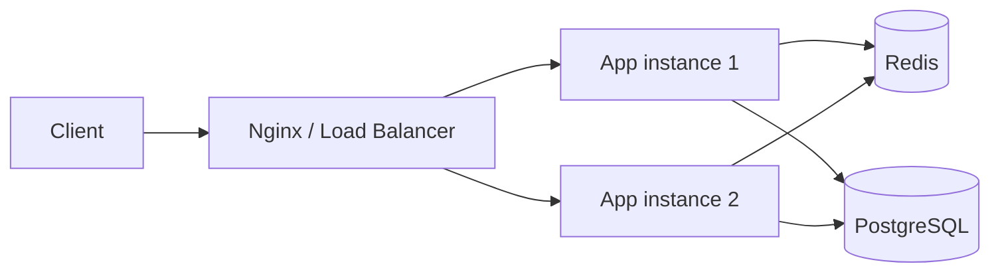

# Distributed URL Shortener

A production-style URL shortener REST API built with **Node.js, TypeScript, Express, PostgreSQL (Drizzle ORM) and Redis**.

It takes long URLs and returns short links (`https://your-domain.com/abc123`) that redirect to the original URL — the same core problem behind bit.ly and TinyURL, designed here with the building blocks of a distributed system: a relational source of truth, a Redis cache on the hot redirect path, atomic rate limiting, and stateless app instances that can be scaled horizontally.

## Features

| Feature | Description |
| --- | --- |
| **Short URL creation** | Random, collision-safe short codes generated with `crypto.randomBytes`, with automatic retry on the rare unique-constraint collision. |
| **Custom aliases** | Optionally pick your own short code (4–12 chars: letters, numbers, `-`, `_`). Returns `409 Conflict` if it is already taken or reserved. |
| **Fast redirects** | Cache-aside pattern: redirects are served from Redis when available, falling back to PostgreSQL (which then repopulates the cache). |
| **Click analytics** | Every redirect atomically increments a Redis counter (`INCR`) without adding latency; a background job flushes counters into PostgreSQL, so `GET /stats` reports lifetime clicks that survive a Redis restart. A failed flush re-credits the Redis counter, so clicks are not dropped when Postgres is briefly unavailable. |
| **URL expiration** | Optional expiry (1–365 days). Expired links return `410 Gone`; the cache TTL is clamped so it never outlives the link, and expiry writes a marker to Redis so expired links are consistently served `410` without repeated Postgres lookups. |
| **Deactivation** | `DELETE` deactivates a link **and tombstones its Redis cache entry**, so a disabled link is never served stale. |
| **Rate limiting** | Distributed, fixed-window limiter implemented as an atomic Lua script (Redis-side `INCR` + `EXPIRE`) with standard `RateLimit-*` headers and `429 Too Many Requests`. Limited **per API key** on management routes (60/min, NAT-safe), **per IP** on redirects (100/min) and key issuance (5/min). |
| **Validated inputs** | Zod schemas for env config and request bodies; only `http`/`https` URLs are accepted. |
| **API key issuance** | `POST /api/v1/keys` issues a management key (`usk_…`) that is shown once and stored only as a SHA-256 hash. Management endpoints require it via `X-API-Key`, and links are owner-scoped: another owner's link returns `404`, never `403`. |

## API

| Method | Endpoint | Description |
| --- | --- | --- |
| `GET` | `/health` | Liveness probe. |
| `POST` | `/api/v1/urls` | Create a short URL. Requires `X-API-Key`. Body: `{ url, expiresInDays?, customCode? }`. |
| `POST` | `/api/v1/keys` | Issue a management API key. Returned once, stored as a SHA-256 hash. |
| `GET` | `/:shortCode` | Redirect (302) to the original URL. `404` unknown, `410` expired or deactivated. |
| `GET` | `/api/v1/urls` | List the authenticated key's URLs. Cursor pagination: `?limit=`, `?cursor=`. Requires `X-API-Key`. |
| `GET` | `/api/v1/urls/:shortCode/stats` | Click count for a short URL. Requires `X-API-Key`. |
| `DELETE` | `/api/v1/urls/:shortCode` | Deactivate a short URL (204). Requires `X-API-Key`. |

### Examples

```bash
# Issue a management API key (shown once - store it)
curl -X POST http://localhost:3000/api/v1/keys

# Create a short URL (authenticated)
curl -X POST http://localhost:3000/api/v1/urls \
  -H "Content-Type: application/json" \
  -H "X-API-Key: usk_xxxxxxxxxxxx..." \
  -d '{ "url": "https://github.com/trending", "expiresInDays": 7, "customCode": "gh-trend" }'

# Response
{
  "shortCode": "gh-trend",
  "originalUrl": "https://github.com/trending",
  "shortUrl": "http://localhost:3000/gh-trend",
  "expiresAt": "2026-11-03T00:00:00.000Z"
}

# Redirect (public)
curl -i http://localhost:3000/gh-trend

# Click stats (authenticated)
curl -H "X-API-Key: usk_xxxxxxxxxxxx..." http://localhost:3000/api/v1/urls/gh-trend/stats

# List your URLs (authenticated, cursor pagination)
curl -H "X-API-Key: usk_xxxxxxxxxxxx..." "http://localhost:3000/api/v1/urls?limit=10"
```

## Architecture



- **App instances are stateless** — any instance can serve any request, so they scale horizontally behind a load balancer.
- **PostgreSQL** is the source of truth (`urls` table: short code, original URL, expiry, active flag, click count).
- **Redis** serves two roles:
  - **Redirect cache** — cache-aside with a 60s TTL, clamped to the link's expiry time.
  - **Hot counters** — clicks are counted with atomic `INCR`/Lua scripts and flushed to Postgres in the background (write-behind), keeping the redirect path fast.

### Design decisions

- **Collision handling:** short codes are 8-char random values; a unique index is the guard, and an insert that violates it simply retries with a new code (up to 3 attempts). Correctness comes from the database, not from hoping.
- **Cache invalidation:** codes are immutable, so cached entries never go stale — except on deactivation, which writes a tombstone over the cache key instead of deleting it. Cache population uses `SET NX`, so a reader that already read the active row from Postgres cannot overwrite the tombstone and briefly resurrect the link.
- **Fail-open Redis:** if Redis is briefly unavailable, redirects and rate limiting degrade to PostgreSQL / unlimited instead of failing requests — the cache is an optimization, not a dependency.
- **Atomic rate limiting:** `INCR` and `EXPIRE` happen inside one Lua script, so the window is correct even under concurrent requests or multiple app instances sharing Redis.

## Project structure

```
src/
├── app.ts                      # Express app (routes, middleware wiring)
├── server.ts                   # Entry point + background flush + graceful shutdown
├── config/                     # Zod-validated env, Redis client
├── controllers/                # HTTP layer: request/response mapping
├── services/                   # Business logic: urls, cache, click stats
├── routes/                     # Route definitions
├── middleware/                 # Rate limiting, error handling
├── validators/                 # Zod request schemas
├── db/                         # Drizzle schema + pooled connection
└── utils/                      # Short code generation
tests/                          # Vitest + Supertest endpoint tests
load/                           # k6 load tests: scenarios + 1-vs-3 replica matrix runner
drizzle/                        # Generated SQL migrations
Dockerfile                      # Multi-stage build: runtime image + one-shot migrate image
docker-compose.yml              # nginx + app × N + postgres + redis topology
nginx/nginx.conf                # Load balancer with Docker-DNS re-resolution
```

## Getting started

**Prerequisites:** Node.js 20+, a PostgreSQL database, and a Redis instance.

```bash
git clone https://github.com/Tirth-955/Distributed-URL-Shortner.git
cd Distributed-URL-Shortner
npm install

cp .env.example .env   # fill in your values
npm run db:migrate     # create/upgrade the schema
npm run dev            # start in watch mode
```

Environment variables (see `.env.example`):

| Variable | Description |
| --- | --- |
| `PORT` | Server port (default 3000). |
| `DATABASE_URL` | PostgreSQL connection string. |
| `DATABASE_SSL` | `true` for cloud Postgres (Neon/Supabase), `false` for local/Docker Postgres. |
| `BASE_URL` | Public base URL used to build short links. |
| `REDIS_URL` | Redis connection string. |
| `RATE_LIMIT_ENABLED` | Set to `false` only for load testing; disables the Redis rate limiters. |

## Running the full distributed stack (Docker Compose)

One command starts the complete topology from the architecture diagram — Nginx, multiple stateless app instances, PostgreSQL and Redis:

```bash
docker compose up --build -d --scale app=2
```

| Service | Role |
| --- | --- |
| `nginx` | The only public entry point (`http://localhost:8080`); round-robins across app replicas. |
| `app` | Stateless API instances (scale with `--scale app=N`). Not exposed directly. |
| `migrate` | One-shot container that applies Drizzle migrations before the app starts. |
| `postgres` | Source of truth (data persisted in a named volume). |
| `redis` | Redirect cache, distributed rate limiting, pending click counters. |

### Verifying the distributed behavior

Each app instance identifies itself in `/health` (its container hostname), which makes the scaling properties observable:

1. **Load balancing** — `GET /health` repeatedly through Nginx: responses alternate between instance IDs (e.g. a 50/50 split across 2 replicas).
2. **High availability** — `docker compose stop app-2` mid-traffic: requests keep succeeding on the surviving instance with no manual intervention; start it back any time.
3. **Distributed rate limiting** — create URLs until `429`, restart *both* app instances, continue: the counter lives in shared Redis, so the 11th request in the 60s window still gets `429` regardless of which instance serves it.
4. **Cross-instance analytics** — redirects served by different instances produce one correct total in `GET /api/v1/urls/:shortCode/stats`.

### A note on the Nginx config

Nginx caches DNS results, which would silently break round-robin over scaled replicas. The config uses Docker's embedded DNS resolver (`127.0.0.11`) with a 10s re-resolution TTL, so the upstream set tracks the live replicas.

### Load testing with k6

`load/run-matrix.ps1` runs a 2×2 matrix — **cached vs uncached redirects** × **1 vs 3 app replicas** — and records **RPS, p95 and p99** per run in `load/results/`, printing a summary table at the end.

```powershell
# Requires k6 (https://k6.io) and Docker Compose in PATH
./load/run-matrix.ps1 -Vus 50 -DurationSeconds 30
```

What each scenario measures:

- **`cached`** — 5 hot codes created in setup, steady traffic across them: after the first hit every redirect is served from Redis, so this profiles the hot path (nginx → app → Redis).
- **`uncached`** — a fresh nonexistent code per request: every request is a Redis miss falling through to Postgres, so this profiles the cold path (nginx → app → Postgres lookup).

Notes:

- The runner boots the stack with `load/docker-compose.load.yml`, which sets `RATE_LIMIT_ENABLED=false` — otherwise the per-IP redirect limiter would turn the run into a 429 generator (all VUs share one source IP). Rate limiting stays on for normal use.
- Replicas scale **1 → 3, never down**, so nginx's 10s DNS re-resolution only ever discovers new instances instead of routing to dead ones.
- The stack is left scaled to 3 replicas with rate limiting disabled; restore with `docker compose up -d --build --scale app=1` (without the override file).

#### Measured results

All services in Docker on one machine (Windows); two independent runs:

**Normal load — 50 virtual users, 30 s per run:**

| Replicas | Scenario | RPS | p50 (ms) | p95 (ms) | p99 (ms) |
| --- | --- | ---: | ---: | ---: | ---: |
| 1 | cached | 1,569 | 32.1 | 44.6 | 54.0 |
| 1 | uncached | 1,748 | 26.0 | 53.7 | 70.6 |
| 3 | cached | 2,916 | 14.6 | 37.8 | 46.0 |
| 3 | uncached | 1,863 | 21.7 | 62.2 | 77.9 |

**Saturation load — 200 virtual users, 60 s per run:**

| Replicas | Scenario | RPS | p50 (ms) | p95 (ms) | p99 (ms) |
| --- | --- | ---: | ---: | ---: | ---: |
| 1 | cached | 2,009 | 105.7 | 168.8 | 290.6 |
| 1 | uncached | 1,519 | 123.8 | 276.1 | 376.0 |
| 3 | cached | 2,955 | 51.9 | 167.2 | 217.7 |
| 3 | uncached | 1,867 | 52.1 | 292.1 | 378.8 |

What the numbers show:

- **Horizontal scaling pays off on the hot path** — at 50 VUs, 1 → 3 replicas lifted cache-hit throughput **1.9×** (1,569 → 2,916 RPS) and cut p50 latency from 32 ms to 15 ms, since each replica serves Redis lookups independently. The gain held under saturation (+47% at 200 VUs).
- **Cache hits beat cache misses** — at 3 replicas, 1.6× more throughput (2,916 vs 1,863 RPS) with p99 46 ms vs 78 ms; under saturation the gap widens further in latency terms (p99 218 ms vs 379 ms).
- **The cache-miss path is the bottleneck** — uncached throughput stayed flat across both runs (1,863 → 1,867 RPS at 3 replicas) with a p95 *regression* under saturation (276 → 292 ms at 1 replica, 62 → 292 ms at 3): every miss funnels into the same single Postgres instance, so extra app replicas just queue behind it. This is exactly the ceiling the Redis cache exists to avoid.
- **~2,950 RPS is the saturation ceiling of the 3-replica topology** — both runs converge on it from opposite directions: 2,916 RPS below saturation (latency still low), 2,955 RPS at saturation (tail latency stretched). Reproducing the same ceiling with two independent load profiles isolates it as a real infrastructure limit rather than measurement noise.

Environment caveat: both k6 and the stack ran on the same machine, so these are throughput-at-the-localhost numbers (the client itself becomes a bottleneck); relative comparisons between runs are meaningful, absolute values are hardware-dependent.


## Scripts

| Command | Description |
| --- | --- |
| `npm run dev` | Start the API in watch mode. |
| `npm run build` | Compile TypeScript to `dist/`. |
| `npm start` | Run the compiled build. |
| `npm test` | Run the test suite (no database or Redis required — external services are mocked). |
| `npm run db:generate` | Generate a migration from the Drizzle schema. |
| `npm run db:migrate` | Apply migrations. |
